# tiny-alexa

**An offline voice assistant for the Raspberry Pi 4.** Say *"Alexa"*, then a
command such as *"set an alarm for 6 AM"*. A 0.23 M-parameter neural network
on the Pi works out what you meant, and the screen and a voice respond. There
is no speech-to-text, no LLM and no cloud: everything runs on the device.

<p align="center">
  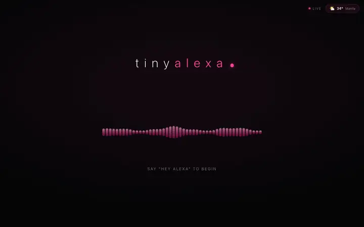
  <br><sub>The browser UI in demo mode: wake word → alarm → lights on → brightness → music.</sub>
</p>

| | |
|---|---|
| **Wake word** | "Alexa" ([openWakeWord](https://github.com/dscripka/openWakeWord) 0.4.0) |
| **Command model** | Two-head TCN, 0.23 M parameters, 0.92 MB ONNX |
| **Understands** | 19 intents, 31 commands (e.g. `ALARM` + `6 AM`) |
| **Test accuracy** | 99.66 % on 1,789 held-out clips from 10 unseen voices (6 errors) |
| **End-to-end (Pi 4)** | 86.1 % command accuracy on the 202-clip VCM holdout, through the real wake word ([Benchmarks](#5-benchmarks)) |
| **Model latency** | 6.8 ms per command on the Raspberry Pi 4 (1-thread ONNX, see [Benchmarks](#5-benchmarks)) |
| **Training data** | 17,851 **synthetic** utterances, 100 synthetic voices ([details](#3-the-dataset)) |
| **Talks back** | Spoken replies through on-device text-to-speech (Piper / espeak-ng / macOS `say`) |

**Contents:**
[1. What it can do](#1-what-it-can-do) ·
[2. How it works](#2-how-it-works) ·
[3. The dataset](#3-the-dataset) ·
[4. Training](#4-training) ·
[5. Benchmarks](#5-benchmarks) ·
[6. Running it](#6-running-it) ·
[7. Limitations](#7-limitations) ·
[8. Project layout](#8-project-layout) ·
[9. Licence](#9-licence)

> **Run it in one command** — `./run.sh`
> Sets up a virtualenv, installs the runtime dependencies (**no torch**) and
> starts the browser voice-control server → open <http://localhost:8321> and
> click to start. First run takes ~30–60 s; later runs start instantly.
> See [6. Running it](#6-running-it).
>
> **Just want to see it?** Open `tiny-alexa.html` in a browser, add `?demo` to
> the end of the address and click. It plays a scripted conversation through
> every scene, with no mic, server or Pi needed.
>
> **See the project story?** Open [`index.html`](index.html) — a
> 4-slide deck (title · architecture · model &amp; results · next steps) with
> the animated pipeline walkthrough, training curves and confusion matrices.
> Also live at <https://charrienacor.github.io/tiny-alexa/>.

---

## 1. What it can do

Each command gets a short spoken and written reply, plus its own animated
scene.

| Lights on/off | Alarm | Music |
|:---:|:---:|:---:|
| 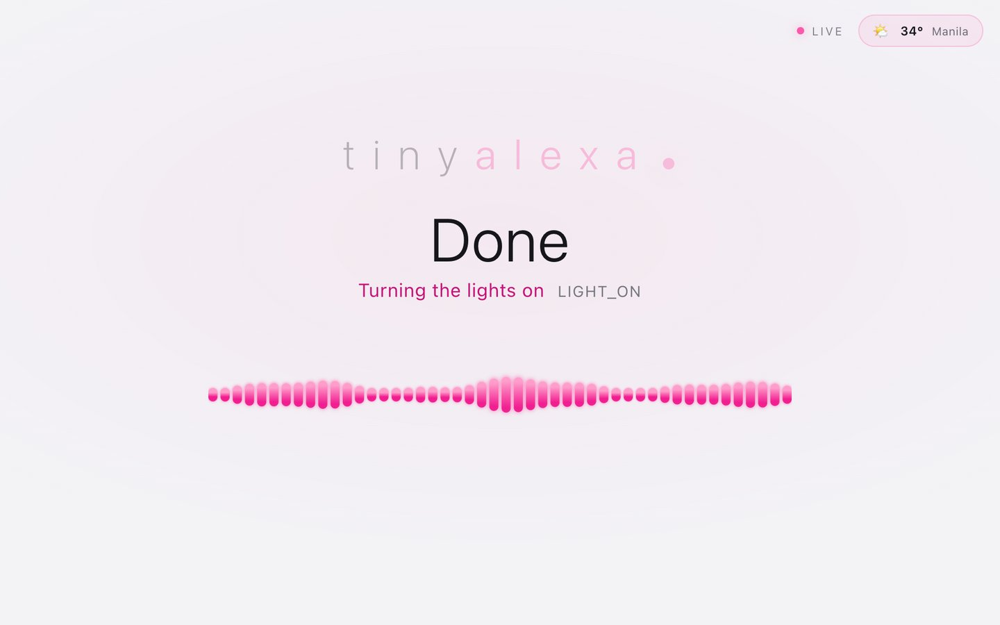 | 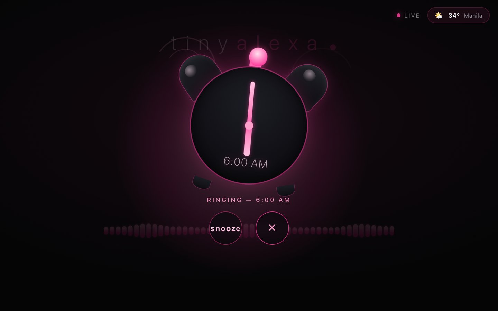 | 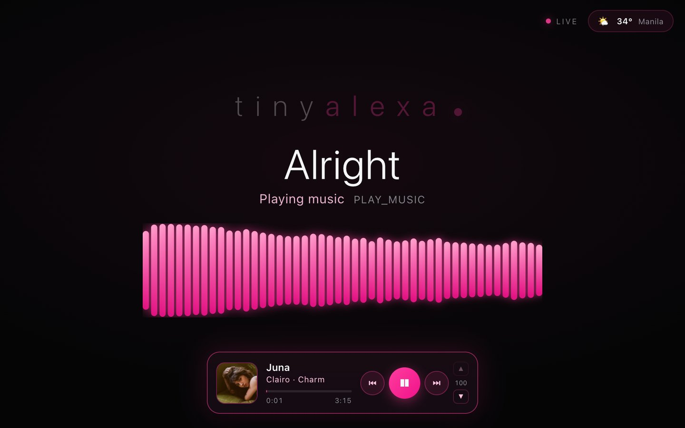 |
| **Timer** | **Temperature** | **Weather** |
| 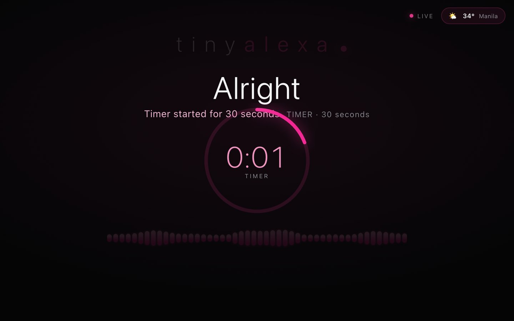 | 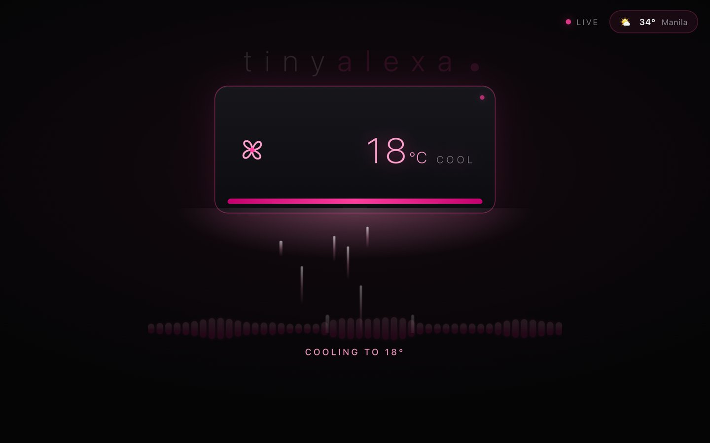 | 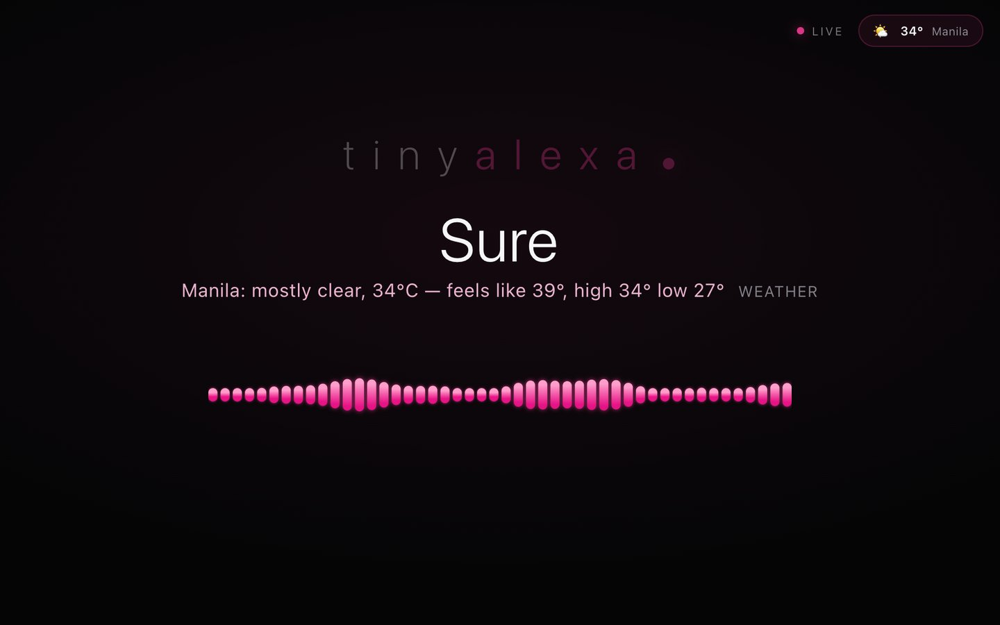 |

<details>
<summary><b>More screens:</b> idle, wake word, brightness, colour, call, message, reminders, rejected command</summary>

| Idle | Wake word heard | Brightness |
|:---:|:---:|:---:|
| 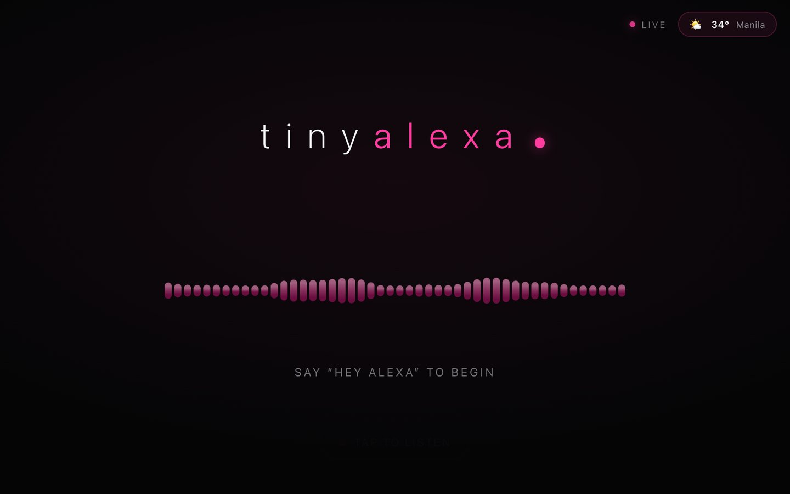 | 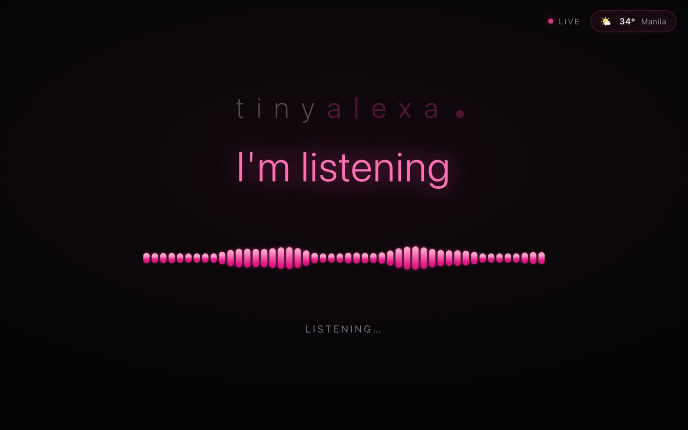 | 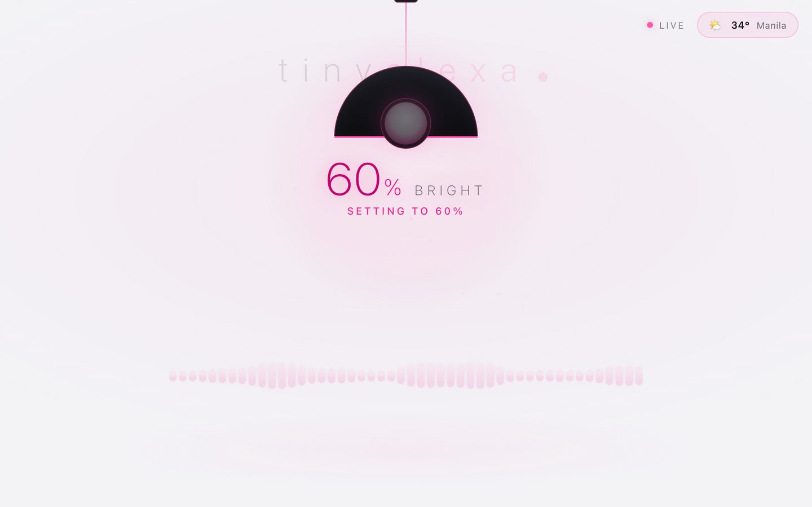 |
| **Colour theme** | **Call** | **Message** |
| 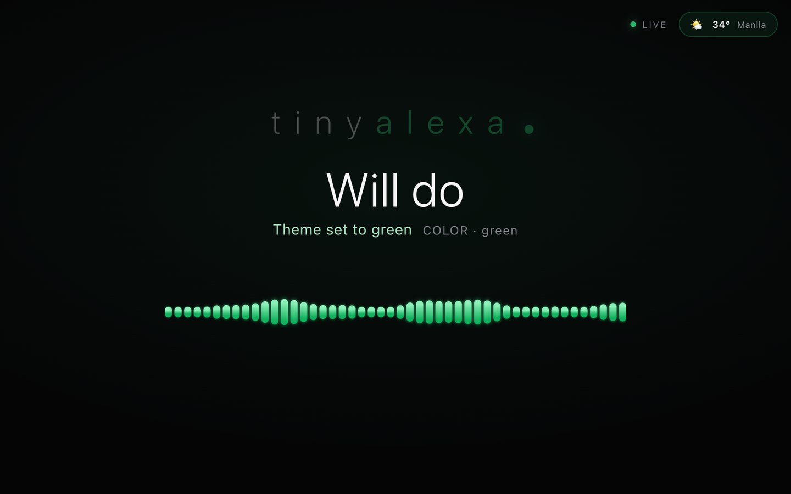 | 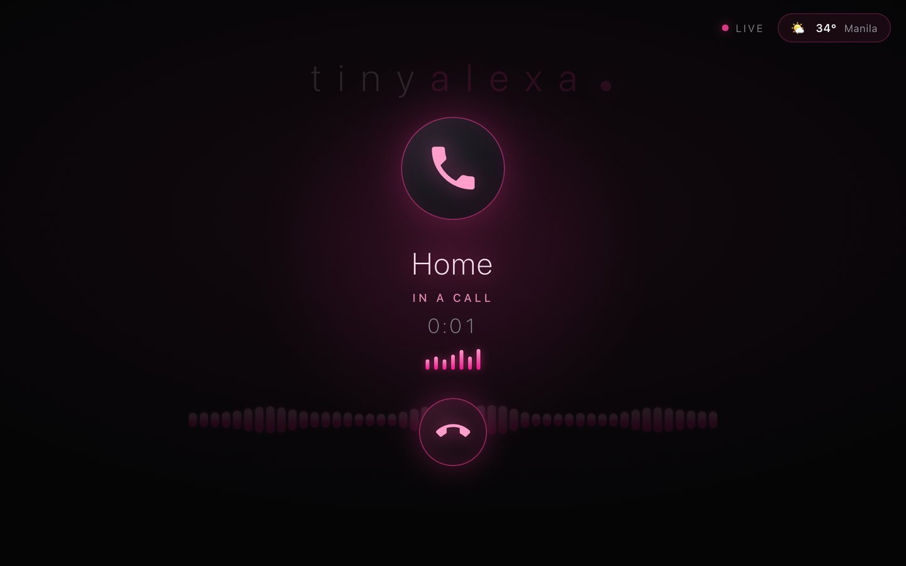 | 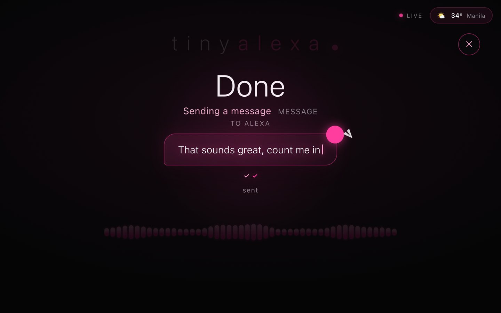 |
| **Reminders** | **Not understood** | |
| 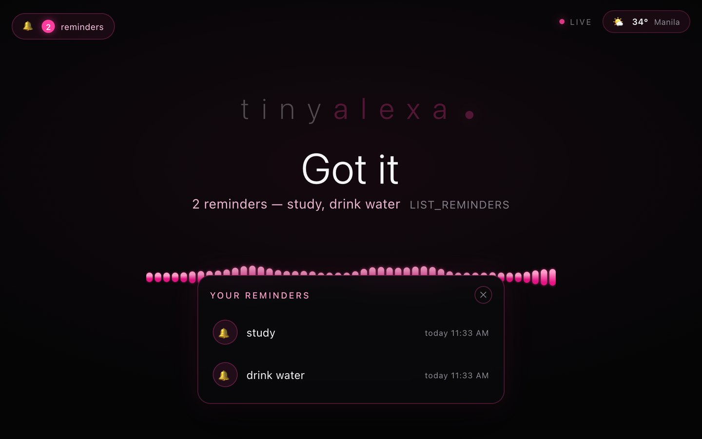 | 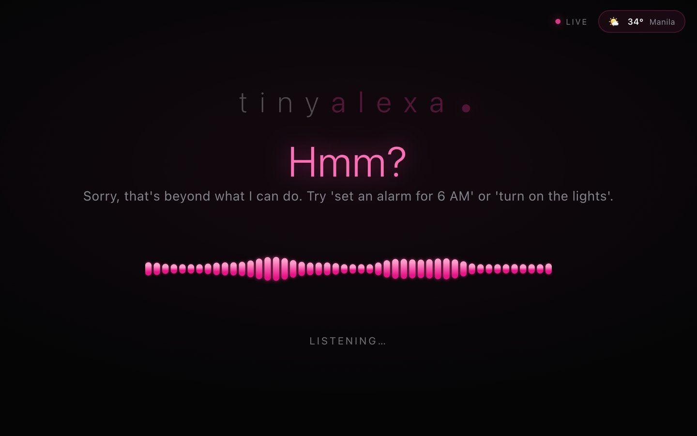 | |

</details>

### Supported commands

Three phrasings were trained per command, and the model only knows these
exact slot values.

| Group | Intent | Example phrase | Slot values |
|---|---|---|---|
| Music | `PLAY_MUSIC` `PAUSE` `STOP` `NEXT` | "Play some music", "Skip song" | — |
| Music | `VOLUME_UP` `VOLUME_DOWN` | "Turn the volume up" | — |
| Lighting | `LIGHT_ON` `LIGHT_OFF` | "Turn on the lights", "Kill the lights" | — |
| Lighting | `BRIGHTNESS` | "Adjust brightness to 60 percent" | 20 / 60 / 100 % |
| Lighting | `COLOR` | "Set color to blue" | red / blue / green |
| Climate | `TEMPERATURE` | "Set the temperature to 22 degrees" | 18 / 22 / 26 °C |
| Timers | `TIMER` | "Start a timer for 30 seconds" | 10 s / 30 s / 1 min |
| Timers | `ALARM` | "Wake me up at 6 AM" | 6 AM / 8 AM / 9 PM |
| Reminders | `CREATE_REMINDER` | "Remind me to drink water" | drink water / study / exercise |
| Reminders | `LIST_REMINDERS` | "Show my reminders" | — |
| Info | `TIME` `WEATHER` | "What time is it?", "Tell me the weather" | — |
| Phone | `CALL` `MESSAGE` | "Make a phone call", "Send a message" | — |

The full list of phrasings is in [data/README.md](data/README.md#phrase-variations).

---

## 2. How it works

The browser handles the microphone, screen and speaker. The Pi does all the
listening and understanding.

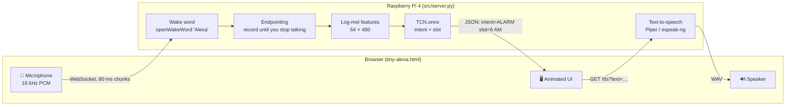

**One interaction, step by step:**

1. **Always listening for "Alexa".** The browser streams microphone audio to
   the Pi in 80 ms chunks. openWakeWord scores every chunk (about 1.5 ms per
   chunk on a laptop CPU).
2. **Wake word heard.** The Pi replies out loud ("Yes?", "Uh-huh") and then
   starts recording. While the reply plays (about 0.5 s), the mic is ignored
   so Tiny-Alexa doesn't hear itself.
3. **Endpointing.** The recording starts when your voice rises clearly above
   the room's noise level, measured just before the wake word. It stops after
   0.56 s of silence. If the model is already ≥ 95 % sure after 0.16 s of
   silence, it answers straight away, which happens for about 74 % of
   commands.
4. **Classification.** The audio becomes a 64 × 480 log-mel spectrogram
   (4.8 s), and the TCN outputs two probability lists: one over the
   19 intents and one over the 19 slot values. They are combined over the
   **31 valid pairs only**, so impossible answers such as `ALARM` +
   `blue` can't happen.
5. **Reply.** The best pair goes to the browser as JSON. The browser runs the
   matching scene and speaks the reply with text-to-speech. If the best pair's
   probability is below **0.4**, the answer is "Sorry, that's beyond what I
   can do" instead.

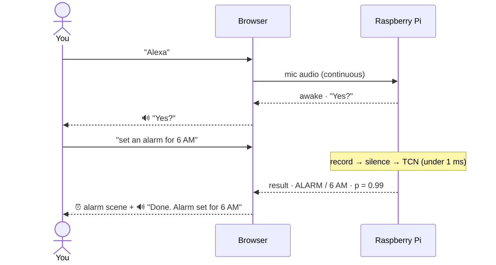

Only a few things use the internet: the weather comes from
[open-meteo](https://open-meteo.com), place names from OpenStreetMap, and
your music from `data/music/` is served locally. **Recognizing commands
never uses the internet.**

---

## 3. The dataset

> [!IMPORTANT]
> **The dataset is entirely synthetic.** No person recorded these commands.
> Every clip was generated by speech synthesis, using reference voices from
> 100 real speakers: 84 from [LibriSpeech](https://www.openslr.org/12) and 16
> Filipino-English speakers from
> [SilencioPH](https://huggingface.co/datasets/SilencioNetwork/tagalog-filipino-speech).
> The test set uses held-out *voices*, but those voices are still synthetic.
> That makes the 99.66 % test score an upper bound: real people in real rooms
> will do worse, and the gap hasn't been measured yet.

> [!WARNING]
> **There is no "unknown" class.** Every training clip is one of the 31
> commands. There are no examples of other speech, background chatter, TV or
> silence. The model therefore always picks *some* command. The only defence
> against out-of-scope speech is the 0.4 confidence threshold, and an
> unrelated sentence can still score above it and trigger the closest
> command. Adding an `UNKNOWN` class (real negative speech) is the most
> useful next improvement.

| | |
|---|---|
| Utterances | **17,851** (8.64 h), kept from 18,600 generated |
| Voices | 100: 84 "foreign" (LibriSpeech) + 16 Filipino-English (SilencioPH) |
| Conditions | Each utterance in two versions: clean and light background noise |
| Phrasings | 3 per intent; slotted intents use 3 templates × 3 values |
| Quality filter | Each clip was transcribed with [simple-audio-transcriber](https://github.com/Martinnavs/simple-audio-transcriber); 749 clips with < 0.80 text similarity were removed |

**Splits are by voice**, so the model is always tested on voices it has never
heard:

| Split | Voices | Utterances |
|---|---|---:|
| Train | `s1–s67` + Filipino `s68–s80` (80) | 14,256 |
| Validation | `s81–s88` + Filipino `s89–s90` (10) | 1,806 |
| Test | `s91–s99` + Filipino `s100` (10) | 1,789 |

The audio (~950 MB) isn't in the repo. Only [`data/manifest.csv`](data/manifest.csv)
(path, label, speaker, split, transcript, duration) and the class tables are.
[data/README.md](data/README.md) has per-class counts and the file naming scheme.

---

## 4. Training

### The model

A **temporal convolutional network (TCN)** made only of 1-D convolutions,
with no RNNs or attention. That keeps it small and fast on the Pi's CPU.

```
log-mel (1 × 64 × 480)
  → 2 strided conv stem   480 → 240 → 120 frames, 32 → 64 channels
  → 5 dilated residual blocks   kernel 5, dilation 1·2·4·8·16, 2 convs each
  → global average pool  (receptive field 1005 frames > 480: sees the whole command)
  → intent head (19)   +   slot head (19, incl. NO_SLOT)
  → joint decode over the 31 valid (intent, slot) pairs
```

### The recipe

| | |
|---|---|
| Loss | Cross-entropy on each head, label smoothing 0.1 |
| Optimizer | AdamW, lr 1e-3, weight decay 0.01 |
| Schedule | 2-epoch linear warm-up, then cosine decay to 1e-5 (40 epochs max, early stop after 10 epochs without improvement) |
| Batch | 64 (223 steps / epoch) |
| Augmentation | Speed 0.9–1.1×, time shift ≤ 0.25 s, white/pink noise at 5–30 dB SNR, SpecAugment (2 × 8 mel bands, 2 × 20 frames) |
| Balancing | Filipino-English clips weighted 2× (they're 16 % of the data) |
| Checkpoint | Best mean of foreign and Filipino validation accuracy |
| Hardware / time | MacBook Air (Apple silicon), **5 min 24 s**, best epoch 29 of 39 |

<p align="center">
  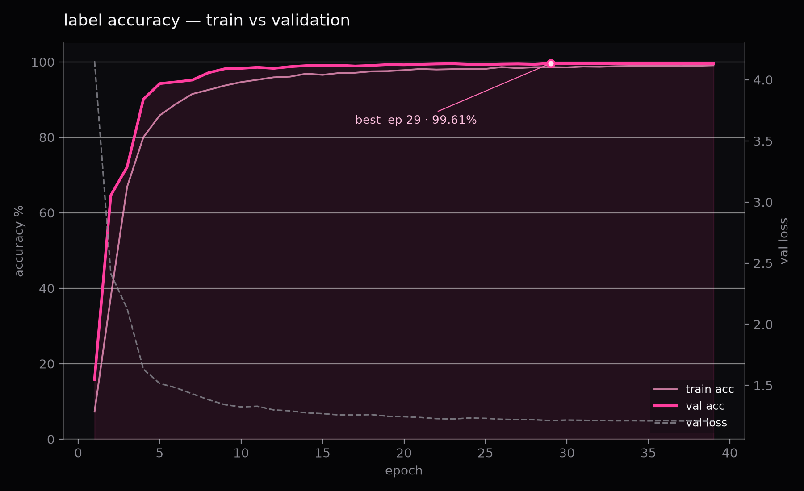
</p>

### Train it yourself

```bash
python -m venv .venv && source .venv/bin/activate
pip install -r requirements.txt     # Python 3.13; torch only needed here, not on the Pi

python src/train.py                 # CUDA, Apple MPS or CPU → models/TCN.pt, results/history.csv
python src/evaluate.py              # test-split metrics + charts → results/
python src/export_onnx.py           # → models/TCN.onnx (add --int8 for a quantized copy)
```

`train.py` options: `--epochs`, `--batch-size`, `--lr`, `--warmup`,
`--weight-decay`, `--label-smoothing`, `--filipino-weight`, `--patience`,
`--seed`. Training needs the dataset audio in `data/<LABEL>/`.

---

## 5. Benchmarks

### Accuracy (test split: 1,789 clips, 10 unseen synthetic voices)

| Metric | Score |
|---|---:|
| **Command** (intent and slot both right) | **99.66 %** (6 errors) |
| Intent | 99.66 % (macro F1 0.994) |
| Slot | 100.00 % |
| Clean / noisy audio | 99.66 % / 99.66 % |
| Foreign / Filipino-English voices | 99.69 % / 99.43 % |

All 6 errors are short commands with no slot, confused with another short
command: `LIGHT_OFF → LIGHT_ON` (3), `TIME → PLAY_MUSIC` (2) and
`CALL → PAUSE` (1). Every command with a slot (alarm, timer, brightness, …)
was 100 % correct.

<details>
<summary><b>Confusion matrices and per-class charts</b></summary>

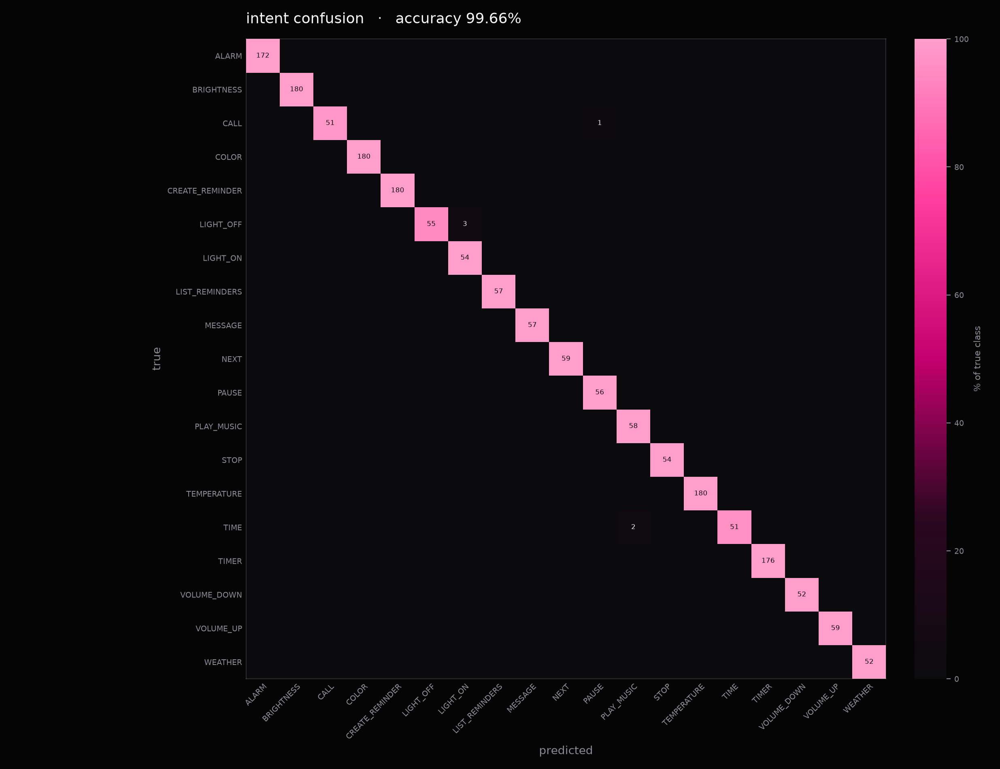
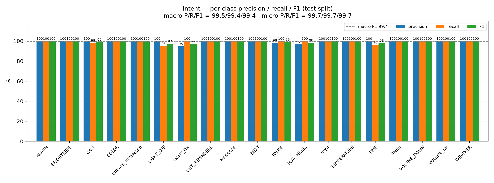

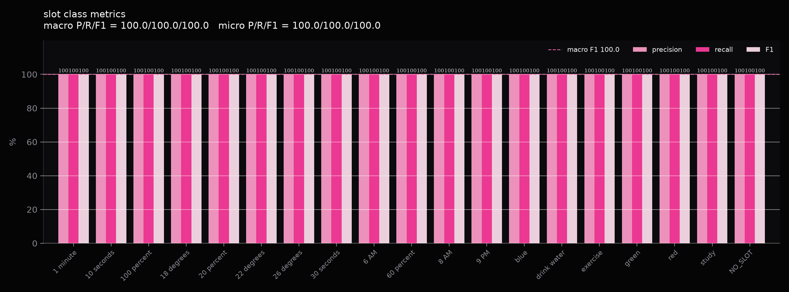

Raw numbers: [results/metrics.txt](results/metrics.txt).
</details>

### Speed and wake word (measured on the Raspberry Pi 4)

> [!NOTE]
> These numbers come from `bench_pi.py` run on **`ai231`, a Raspberry Pi 4
> (Cortex-A72, aarch64)**, Python 3.13.5, onnxruntime 1.31.0, 1 thread. The
> report says which machine it came from — regenerate with
> `python3 src/bench_pi.py` to refresh them.

| Measurement | Result |
|---|---|
| TCN inference, 1 thread | p50 6.78 ms · p95 6.89 ms (n = 200) |
| Real-time factor | ~700× (4.8 s of audio in 6.8 ms) |
| Wake word, per 80 ms chunk | p50 20.5 ms · p95 22.2 ms (n = 100) |
| Features + TCN per command | p50 29.3 ms · p95 30.2 ms (n = 50) |
| Wake word hit rate | 202 / 202 holdout clips (100 %) |
| Wake word false accepts | 0 / 202 clips of non-wake audio |
| Model size | 898 KB (`TCN.onnx`, fp32) |

What you notice as a user is mostly **endpointing time**, not compute: the
reply comes 0.16 s after you stop speaking for most commands, and at most
0.56 s after.

### End-to-end on the Pi 4: the VCM holdout

`bench_pi.py` also runs the class holdout set (the same 202 "Alexa + command"
clips the [vcm-benchmark](https://github.com/airimonda/vcm-benchmark) harness
uses) **through the real pipeline on the Pi**: streaming wake word → 4.8 s
window → TCN. Positives are "Alexa" + pause + command; negatives are the same
commands with no wake word.

| Metric | Result |
|---|---:|
| Wake word fired | 202 / 202 (100 %, CI 98.1–100) |
| **Command accuracy** (intent + slot both right) | **86.1 %** (174 / 202, CI 80.7–90.2) |
| False accepts (out-of-scope commands obeyed) | 10 / 16 (62.5 %) |
| False rejects (in-scope commands refused) | 5 / 186 (2.7 %) |
| Misfires (wrong intent or slot) | 13 / 186 (7.0 %) |
| Slot exact (where a slot was expected) | 101 / 101 (100 %) |
| False wakes (wake word fired on negatives) | 0 / 202 (0 %) |
| Inference latency, end-to-end | p50 22.9 ms · p95 29.7 ms (RTF p95 ≈ 0.006) |

The gap between the 99.66 % test-split accuracy and the 86.1 % end-to-end
number is the honest cost of the full chain: the holdout clips carry real
room noise and speaker variation the synthetic test split doesn't, the model
has to survive a 0.8 s gap after the wake word, and the 16 out-of-scope
commands (e.g. "play some music" said *without* "Alexa") are the ones it
still obeys. That is the known weak spot — out-of-scope rejection — and the
one the next iteration targets.

The wake-word clips themselves aren't in the repo (audio stays local); only
[`data/wake_tests/manifest.csv`](data/wake_tests/manifest.csv) ships, with the
expected label, slot and transcript for every clip.

### Reproduce

```bash
python src/bench_gpu.py              # training report  → results/gpu_report.json
python3 src/bench_pi.py              # on the Pi: wake word + latency + VCM holdout → results/pi_report.json
python3 src/bench_pi.py --accuracy 200   # + ONNX accuracy on 200 test clips (needs scipy)
python src/dashboard.py              # merge both → results/dashboard.md
```

---

## 6. Running it

### One command (recommended)

```bash
./run.sh
```

That's it. `run.sh` creates a virtualenv (once), installs the minimal runtime
dependencies — **no torch, no training deps** — and starts the browser
voice-control server. Open <http://localhost:8321> and click to start. First
run takes ~30–60 s to install; later runs start instantly. Pass any server flag
straight through: `./run.sh --debug`.

Manual equivalent, if you'd rather not use the script:

```bash
python3 -m venv .venv && source .venv/bin/activate
pip install numpy soundfile onnxruntime openwakeword==0.4.0 "aiohttp>=3.9"
python src/server.py                 # then open http://localhost:8321 and click to start
```

On macOS the replies use the built-in `say` voice automatically.

### Demo only (any computer, 10 seconds, no install)

Open `tiny-alexa.html` in Chrome, Edge or Safari, add `?demo` to the end of
the address (`…/tiny-alexa.html?demo`), press Enter and click anywhere. Add
`&debug` to also show the model-latency chip.

### Raspberry Pi 4

1. **Copy to the Pi:** `src/`, `data/labels.json`, `data/manifest.csv`,
   `models/TCN.onnx` and `tiny-alexa.html`. The Pi doesn't need torch.
2. **Install:**
   ```bash
   python3 -m venv pi-venv && source pi-venv/bin/activate
   pip install numpy soundfile onnxruntime openwakeword==0.4.0 "aiohttp>=3.9"
   sudo apt install espeak-ng        # a voice for spoken replies (see below for a nicer one)
   ```
3. **Run:** `python3 src/server.py`, then open `http://<pi-ip>:8321`.

> [!TIP]
> Browsers only allow the microphone on `https://` or `http://localhost`.
> Open the page on the Pi itself, or put an HTTPS proxy in front of it to use
> another device.

**Optional extras**

| Want | Do |
|---|---|
| A natural voice | `pip install piper-tts` and put a [Piper voice](https://huggingface.co/rhasspy/piper-voices) (`.onnx` + `.onnx.json`) in `models/tts/` |
| Music | Put `.mp3` / `.m4a` / `.ogg` / `.flac` files in `data/music/` (`pip install mutagen` for exact durations) |
| Weather for your location | Allow location in the browser; otherwise the city from your IP address is used |
| No browser at all | `python src/infer.py` (live mic, needs `sudo apt install libportaudio2` + `pip install sounddevice`) or `python src/infer.py --file a.wav` |

**Server options** (`python3 src/server.py --help`):

| Flag | Default | What it does |
|---|---|---|
| `--port` | 8321 | HTTP / WebSocket port |
| `--threshold` | 0.5 | Wake-word sensitivity (lower = triggers more easily) |
| `--int8` | off | Use `models/TCN_int8.onnx` if it exists |
| `--tts` | `auto` | Voice engine: `piper`, `espeak`, `say`, `browser` (the browser's own voice) or `off` |
| `--voice` | first in `models/tts/` | Which Piper voice to use |
| `--no-wake-ack` | off | Don't say "Yes?" after the wake word, so you can speak the command without pausing |
| `--debug` | off | Print every detection, confidence and latency |

**Using it:** say **"Alexa"**, wait for the "Yes?" (about half a second), then
say the command. Saying "Alexa" again while it's talking interrupts the reply.

---

## 7. Limitations

- **Synthetic training data.** The model was trained on synthetic speech;
  real-room holdout testing on the Pi 4 measures the gap at 86.1 % command
  accuracy vs 99.66 % on the synthetic test split.
- **Out-of-scope rejection is the weak spot.** On the 202-clip VCM holdout
  the model obeyed 10 of 16 out-of-scope commands (e.g. "play some music"
  without the wake word). Unknown speech is only filtered by a confidence
  threshold, so it can trigger the closest command (see
  [the dataset](#3-the-dataset)).
- **Closed vocabulary.** Only the slot values above are understood. "Set a
  timer for 5 minutes" may be rejected or mapped to a similar-sounding
  command.
- **Short pause after "Alexa".** The spoken "Yes?" makes the mic deaf for
  about 0.5 s. Use `--no-wake-ack` if you prefer saying it all in one breath.

---

## 8. Project layout

| Path | What |
|---|---|
| `tiny-alexa.html` | The whole browser UI: mic capture, scenes, music player, speech (one file, no build step) |
| `index.html` | The 4-slide project deck: animated architecture walkthrough, training curves, confusion matrices (self-contained, served by GitHub Pages) |
| `src/server.py` | Pi server: wake word, endpointing, TCN, text-to-speech, music and geo endpoints |
| `src/infer.py` | Wake-word detector and command model classes, plus a terminal version of the assistant |
| `src/features.py` | NumPy log-mel front end, shared by training and the Pi |
| `src/model.py` | The two-head TCN |
| `src/dataset.py` | Manifest-driven dataset and augmentation |
| `src/train.py` · `src/evaluate.py` · `src/export_onnx.py` | Train → evaluate → export to ONNX |
| `src/bench_gpu.py` · `src/bench_pi.py` · `src/dashboard.py` | Benchmark reports and the merged dashboard |
| `models/` | `TCN.pt` (PyTorch), `TCN.onnx` (deployed), `tts/` (optional Piper voices) |
| `data/` | Manifest and class tables (audio kept locally), `wake_tests/`, `music/` |
| `results/` | Metrics, charts, training history, benchmark reports |
| `docs/media/` | Screenshots and the demo animation used in this README |

---

## 9. Licence

Code and model weights are released under the **MIT licence** — see
[`LICENSE`](LICENSE). The weights in [`models/`](models/README.md)
(`TCN.onnx`, `TCN.pt`) are covered by the same licence.

**Data caveat:** the weights were trained on the synthetic command corpus at
[`github.com/markandrian30/AI231/MEX2/Data`](https://github.com/markandrian30/AI231/tree/main/MEX2/Data).
That corpus is derived audio built from source recordings under their own
(restrictive) licences; it is **not** redistributed here and remains subject
to its own terms before commercial use.
